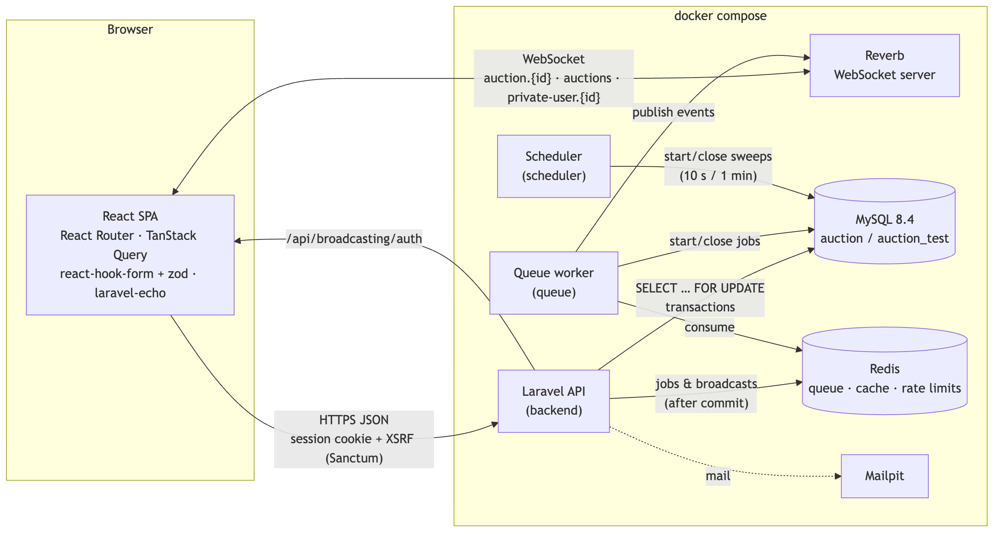
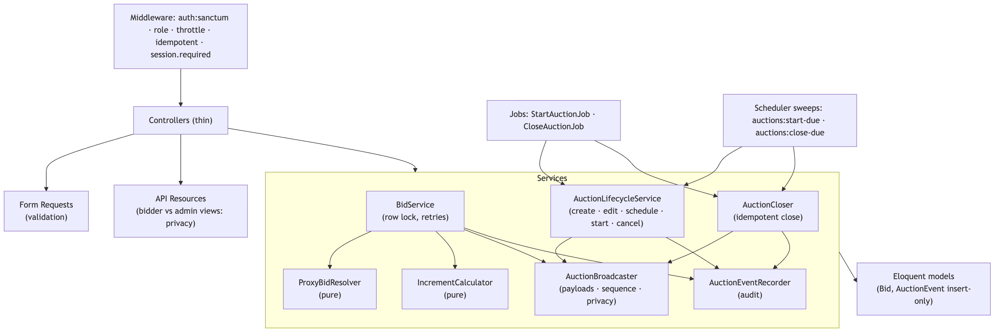
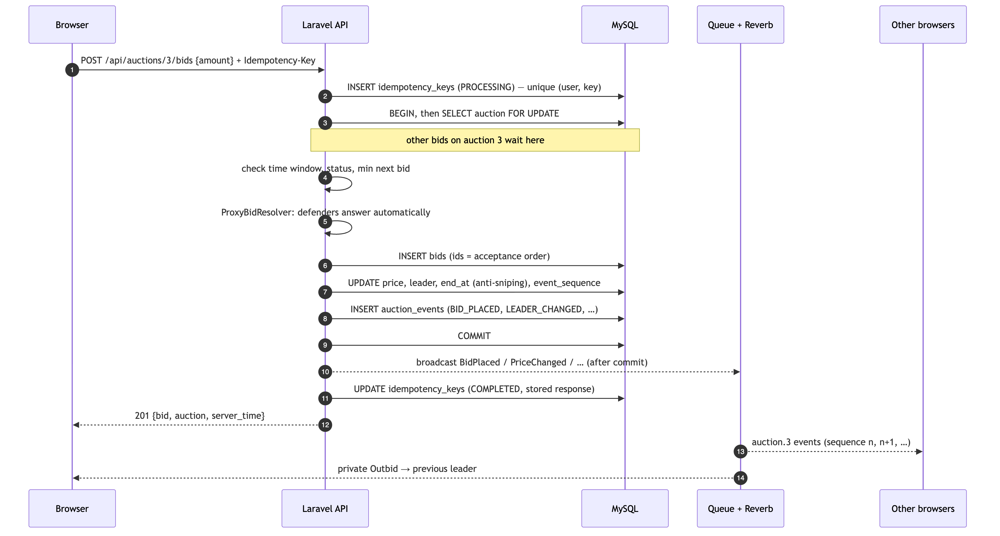
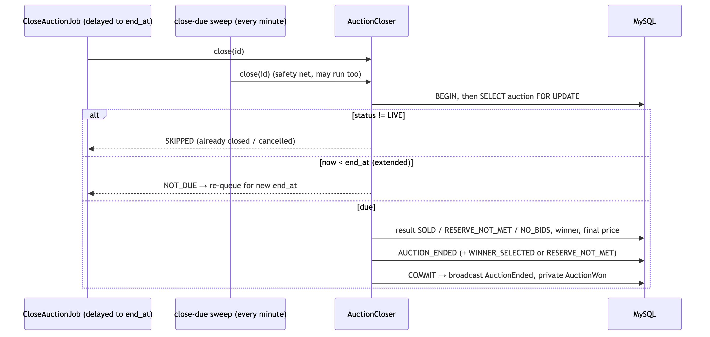
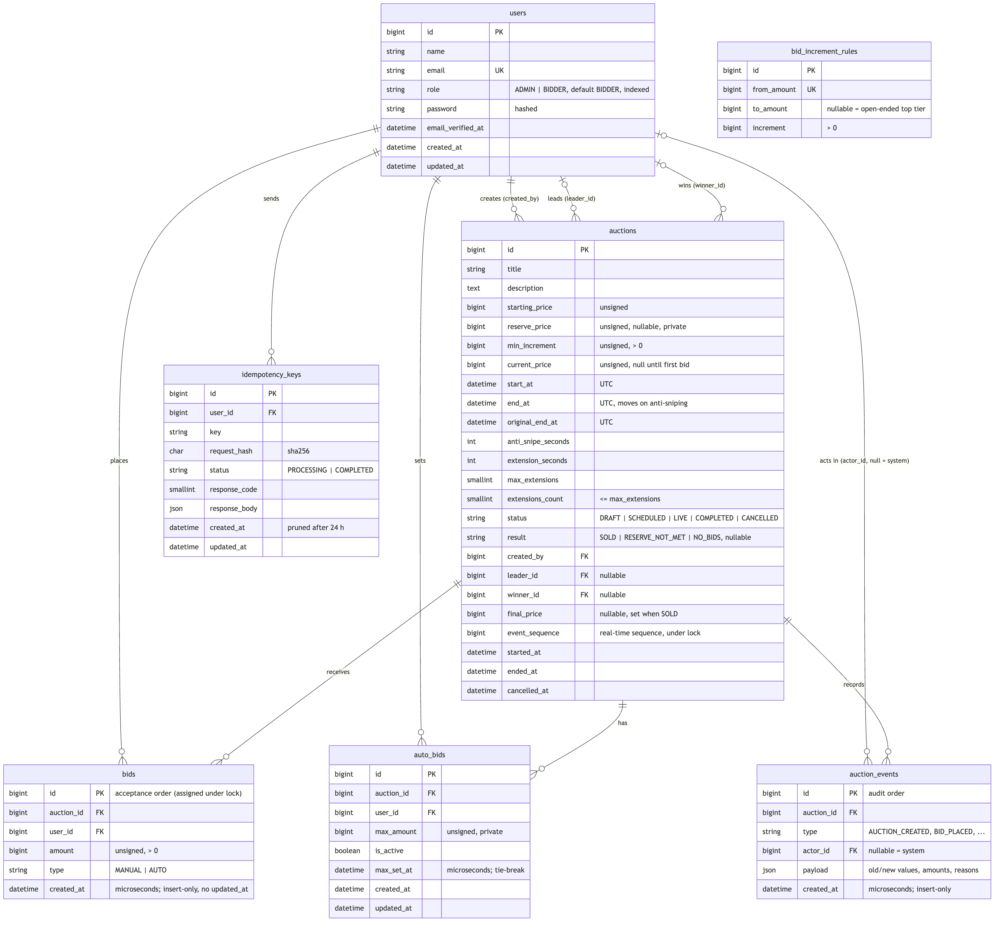

# Real-Time Auction Platform

[](https://github.com/sachithnim/Real-Time-Auction-Platform/actions/workflows/ci.yml)

A web-based live auction platform where multiple bidders compete on the same auction at the same time.
The backend is the single authority on bid validity, and every bid is processed under a database row lock.
The system supports proxy (automatic) bidding, dynamic bid increments, anti-sniping extensions,
private reserve prices and real-time updates over WebSockets.

## Stack

| Layer     | Technology                                                           |
|-----------|----------------------------------------------------------------------|
| Frontend  | React, TypeScript, Vite, React Router, TanStack Query                |
| Backend   | Laravel 13 (PHP 8.3+), Sanctum SPA auth, Laravel Reverb (WebSockets) |
| Database  | MySQL 8.4 (InnoDB)                                                   |
| Infra     | Redis (queue, cache, rate limiting), scheduler, queue worker, Docker |

## Repository layout

```
backend/            Laravel REST API
frontend/           React + TypeScript SPA (Vite)
docker/             Docker files and init scripts
docs/images/        Architecture and database diagrams
docker-compose.yml  Whole stack: MySQL, Redis, API, queue, scheduler, Reverb, frontend
```

## Documentation

| Document | Where |
|---|---|
| **API documentation** (every endpoint with headers, body and example responses) | **https://documenter.getpostman.com/view/38987690/2sBYHSxfqH** |
| Architecture diagrams | [Architecture](#architecture) below |
| Database ER diagram | [Database](#database) below |

## Quick start with Docker

Requires only Docker Desktop. From a fresh clone:

```bash
docker compose up -d --build
```

Then open **http://localhost:5173**. No `.env` file needs to be created by hand: `docker-compose.yml` provides every
setting the containers need. The first start takes a little longer while Composer and npm install dependencies.

| Service  | URL / address                     | Notes                                              |
|----------|-----------------------------------|----------------------------------------------------|
| Frontend | http://localhost:5173             | Vite dev server with hot reload                    |
| API      | http://localhost:8000             | Laravel; migrates and seeds itself on start        |
| MySQL    | `127.0.0.1:3307`                  | `auction` / `secret`, for database GUI tools       |
| Redis    | internal only                     | Used by the backend container                      |
| Reverb   | ws://localhost:8080               | WebSocket server (Laravel Reverb)                  |
| Queue    | (background)                      | `queue:work`: start/close jobs and broadcasts      |
| Scheduler| (background)                      | `schedule:work`: start/close safety sweeps         |

On start, the backend container installs Composer dependencies if missing, creates `.env` from
`.env.example` on a fresh clone, runs migrations and the (idempotent) seeders. Source folders are
bind-mounted, so code changes apply without rebuilding.

```bash
docker compose ps                 # status of every service
docker compose logs -f backend    # follow API logs
docker compose exec backend php artisan test
docker compose down               # stop (add -v to also delete the database volume)
```

Do not run `php artisan serve` or `npm run dev` on the host at the same time: they would compete for
ports 8000 and 5173.

### Demo accounts

All demo accounts use the password `password` (local development only).

| Role   | Email                                           |
|--------|-------------------------------------------------|
| Admin  | `admin@auction.test`                            |
| Bidder | `bidder1@auction.test` … `bidder5@auction.test` |

The seeders create the bid increment tiers and one demo auction in each lifecycle state (draft, scheduled,
live, completed). Reset the demo data at any time with
`docker compose exec backend php artisan migrate:fresh --seed`.

### Try it in two minutes

The live demo auctions stay open for a few days after seeding; if they have ended, reset the demo data first.

1. Open http://localhost:5173 in two browsers (or one normal and one private window). Log in as `bidder1@auction.test`
   in one and `bidder2@auction.test` in the other.
2. Both open **Hand-Carved Kandyan Mask** (starting price 5,000). bidder1 sets an automatic bid with a maximum of
   20,000 and leads at the starting price; bidder2 bids 15,000.
3. Both windows update instantly. bidder1's automatic answer of 15,500 appears in the history, and bidder2 gets an
   "Outbid" notification. bidder1's 20,000 maximum is never shown to bidder2.
4. Log in as `admin@auction.test`, open **Manage auctions**, choose the auction and read its **Audit log**.

## Local setup without Docker

### Prerequisites

- PHP 8.3+ with `pdo_mysql`, `pcntl`, `bcmath`
- Composer 2
- Node.js 22+ and npm
- Docker (for MySQL)
- Redis on `localhost:6379` (e.g. `brew install redis && brew services start redis`)

### 1. Infrastructure

Start only the database; PHP and Node run on the host.

```bash
docker compose up -d --wait mysql
```

| Service | Host port  | Notes                                                             |
|---------|------------|-------------------------------------------------------------------|
| MySQL   | 3307       | db `auction`, user `auction` / `secret`; test db `auction_test`   |

The `auction_test` database is created by `docker/mysql/init/01-create-test-db.sql` the first time the
MySQL volume is initialised.

### 2. Backend

```bash
cd backend
composer install
cp .env.example .env
php artisan key:generate
php artisan migrate --seed   # schema + demo data
php artisan serve            # http://localhost:8000
```

`php artisan migrate:fresh --seed` rebuilds the database from scratch at any time.

The demo accounts are listed [above](#demo-accounts).

### 3. Frontend

```bash
cd frontend
npm install
cp .env.example .env         # set VITE_REVERB_APP_KEY to the backend's REVERB_APP_KEY
npm run dev                  # http://localhost:5173
```

For live updates outside Docker, also run the background processes in separate terminals:
`php artisan queue:work`, `php artisan schedule:work` and `php artisan reverb:start`.

## Running the tests

```bash
# Inside Docker
docker compose exec backend php artisan test
docker compose exec frontend npm test -- --run

# Backend on the host — runs against MySQL `auction_test`, never SQLite
cd backend && php artisan test

# Only the parallel-process concurrency tests
cd backend && php artisan test --group=concurrency

# The workers' start-up wait is measured automatically; override it if needed
docker compose exec -e CONCURRENCY_BOOT_SECONDS=45 backend php artisan test --group=concurrency

# Frontend (bid form validation, countdown, server clock, live-event ordering, error messages)
cd frontend && npm run typecheck && npm run lint && npm test -- --run
```

GitHub Actions runs the same checks on every pull request and every push to `main` (`.github/workflows/ci.yml`):
backend code style (Pint) and the full test suite against a MySQL 8.4 service, and frontend typecheck, lint, tests
and production build. Dependabot (`.github/dependabot.yml`) checks Composer, npm, GitHub Actions and the PHP base image
every Monday and opens grouped update PRs, which go through the same checks before they can be merged.

Backend tests deliberately use MySQL: the bid engine relies on `SELECT ... FOR UPDATE` row locks, which
SQLite does not support, so locking tests on SQLite would prove nothing. A guard test
(`tests/Feature/TestDatabaseTest.php`) fails if the suite is ever pointed at another database. `phpunit.xml` forces
`auction_test` even inside the containers, where Docker's own environment says `auction`, so running the tests can
never touch the development data.

## Authentication

The SPA uses Laravel Sanctum's cookie-based session authentication, not bearer tokens, so no token is
ever stored in browser JavaScript. The browser first calls `GET /sanctum/csrf-cookie`, then
`POST /api/auth/login` or `POST /api/auth/register`. CORS allows credentialed requests only from
`FRONTEND_URL`. Self-registration always creates a bidder account; the admin account is seeded.

## Frontend

React 19, TypeScript and Vite, with React Router, TanStack Query, axios, react-hook-form with zod, laravel-echo with
pusher-js, and Tailwind CSS.

```
src/
  lib/            api client, error messages, server clock, countdown, money, retries, Echo
  features/
    auth/         login, registration, route guards
    auctions/     listing, live auction screen, bid form, auto-bid form, bid history, result
    realtime/     event reducer (sequence handling), channel hooks, private notifications
    admin/        auction management, create/edit form, audit log
  components/     layout, UI kit, toasts, countdown
```

**Screens.**
- Bidders: login and register, the auction list (live updates, filter tabs) and the live auction screen. That screen
  shows price, leader ("You" or "Bidder N"), whether the reserve is met, a countdown that turns red inside the
  anti-sniping window, the bid form, auto-bid setup, the live bid history and the result.
- Admins: the auction table, create and edit (draft only), schedule, cancel with a reason, the audit log and the bid
  history with identities.

**Server-time countdown.** Every API response carries `meta.server_time`. The client measures each request's round
trip and estimates the offset between its clock and the server's, preferring short round trips. Countdowns tick on
`serverNow()`, so a wrong local clock does not matter. The server still decides whether a bid is on time.

**Live state.** `applyAuctionEvent` (a pure function, unit-tested) applies one event to the cached auction. An event
at or below the snapshot's `sequence` is ignored. A skipped sequence means an event was missed, so the auction and
history are re-fetched; the same happens after any WebSocket reconnect. As a safety net, the screen also re-fetches
shortly after the scheduled start or end.

**Errors and double submission.** Each bid or auto-bid attempt gets one `Idempotency-Key`. Network failures,
`BID_CONFLICT_RETRY`, `DUPLICATE_REQUEST` and 5xx are retried automatically with the same key, so a retry can never
place a second bid. The submit button is disabled while a request is in flight. Every API error code maps to a
message the user can act on (e.g. "Your bid is too low. The minimum is now Rs. 26,000."). An expired CSRF token is
refreshed and the request replayed once.

## Architecture

### Components



### Backend layers



- **Thin controllers.** Controllers only connect HTTP to the services. Validation lives in Form Requests. Output and
  privacy rules live in API Resources (bidder and admin views are separate classes).
- **Pure calculations.** `IncrementCalculator` and `ProxyBidResolver` have no database access and are unit-tested in
  isolation.
- **One authority for changes.** Every state change goes through a service that locks the auction row, writes its
  audit event in the same transaction, and hands real-time events to `AuctionBroadcaster`. Those events are sent
  only after commit.

### A bid, end to end



### Closing an auction



## Database



- Money columns are `BIGINT UNSIGNED` whole rupees; times are UTC.
- MySQL `CHECK` constraints refuse impossible auctions (end before start, reserve below the starting price, zero
  increment, more extensions than allowed).
- `bids` and `auction_events` are insert-only. Bids are ordered by their auto-increment `id`, assigned under the
  auction row lock.
- Unique indexes: one auto-bid per bidder per auction (`auction_id, user_id`); one idempotency key per user
  (`user_id, key`).

## Technical decisions

How the hardest parts work, and why they were built this way.

### Concurrency

Every bid is handled by `BidService` in **one database transaction that starts by locking the auction row**
(`SELECT ... FOR UPDATE`):

1. The lock is taken first. Concurrent bids on the same auction queue on this lock and run one at a time, in the order they
   acquire it. Bids on different auctions lock different rows and never wait for each other.
2. Only then is the server clock read and the bid validated against the locked row: time window (regardless of status, so a
   bid after `end_at` is refused even before the closing job runs), status, and the minimum next bid from
   `IncrementCalculator`. The client's idea of the price is never trusted.
3. The bid is inserted, `current_price` and `leader_id` are updated, and `BID_PLACED` / `LEADER_CHANGED` audit events are
   written in the same transaction, so either everything commits or nothing does.
4. Bid history is ordered by the auto-increment `id`, which is assigned while the lock is held, so the order is exactly the
   acceptance order.

If the lock cannot be obtained within a few seconds (`AUCTION_BID_LOCK_WAIT_SECONDS`) or MySQL reports a deadlock, the
transaction is retried (`AUCTION_BID_TRANSACTION_ATTEMPTS`) and finally answered with `409 BID_CONFLICT_RETRY`. Rejected
bids are recorded as `BID_REJECTED` after the rollback.

**Duplicate requests.** Bid requests carry an `Idempotency-Key` header (a UUID per user action). The key is claimed in its own
committed insert, guarded by a unique index on `(user_id, key)`, before the bid runs. A retry of a finished request replays the
stored response, a retry while the first is still running gets `409 DUPLICATE_REQUEST`, and reusing a key for a different
body gets `422`. Retryable outcomes (`5xx`, `429`, `BID_CONFLICT_RETRY`) are not stored, so they can be retried with the same
key.

Tests run on MySQL, never SQLite, because SQLite has no row locks. One test holds the auction lock from a second database
connection and proves that a blocked bid ends in `BID_CONFLICT_RETRY` without changing anything.

**Concurrency tests with real parallel processes** (`tests/Feature/Concurrency`, group `concurrency`). Each test starts
several separate PHP processes with Laravel's Process pool. Every process boots the app with its own MySQL connection,
waits for a shared start time, then acts at the same instant against committed data:

- **Assignment example.** At price 50,000, A bids 51,000, B 51,500 and C 51,000 at once, on five auctions in parallel.
  Exactly one bid wins (whichever took the lock first). The others are rejected as too low, and price, leader, history and
  audit events agree.
- **Stress.** Eight processes repeatedly bid the minimum on one auction. Every stored bid respects the increment, ids
  follow acceptance order, and every accepted bid is stored exactly once.
- **Proxy.** A's auto-bid of 20,000, B's auto-bid of 15,000 and C's manual 12,000 arrive together. Every ordering ends
  with A leading at 15,500.
- **Duplicates.** The same HTTP request with the same `Idempotency-Key` is sent five times at once. One bid is placed;
  the other responses are a replay of the result or `409 DUPLICATE_REQUEST`.
- **Closing.** Three closers at once give exactly one `AUCTION_ENDED`. Bids racing the close from 60 ms before to 60 ms
  after `end_at` are either in the final result or rejected with nothing stored.

The tests were checked against a broken build: with `lockForUpdate()` removed they fail, with two winners and bids
accepted below the minimum.

### Automatic (proxy) bidding

A bidder can set a private maximum (`PUT /api/auctions/{id}/auto-bid`). The system then bids for them **only as much as
needed** to stay in the lead. The maximum is never broadcast, never returned to anyone but its owner, and never shown in
the public history.

The arithmetic lives in `ProxyBidResolver`, a pure class with no database access that is unit-tested on its own.
`BidService` calls it **inside the same auction row lock** as every other bid:

- **Defenders** are the other bidders' active maximums, plus the current leader's price if they lead with a manual bid.
  They are ranked by maximum (highest first), then by when that maximum was set (earliest first).
- **The challenger wins** if its amount beats the strongest defender. An auto-bid pays only
  `min(own max, defender max + increment(defender max))`. A manual bid is taken literally, at the amount the bidder
  typed.
- **The defender holds** otherwise. The challenger's bid is recorded, then the defender answers automatically with
  `min(defender max, challenger + increment(challenger))`. With equal maximums, whoever committed to the amount first
  wins, at that amount.
- **Updates.** Visible bids are inserted in order, and price and leader are updated. Auto-bids that can no longer place a
  valid bid are switched off (`AUTO_BID_MAX_REACHED`) so their owners can be told.

Example from the assignment, with an increment of 500: A's maximum is 20,000 and B's is 15,000. A leads at **15,500**:
B's bid shows at 15,000 and A answers with one increment. A's 20,000 stays private.

A leader can raise their maximum without placing a visible bid. A maximum can never be lowered, and it must be at least
the next valid bid (`422 MAX_AUTO_BID_REACHED`).

### Starting, anti-sniping and closing

**Starting.** Scheduling an auction queues a `StartAuctionJob` delayed until `start_at`. The job moves it from
SCHEDULED to LIVE under the auction row lock and records `AUCTION_STARTED`. As a safety net, `auctions:start-due` runs
every 10 seconds. Starting is idempotent: it only acts on a SCHEDULED auction whose start time has passed.

**Anti-sniping.** Inside the bid transaction, if an accepted bid arrives at or after `end_at - anti_snipe_seconds` and
`extensions_count < max_extensions`, then `end_at += extension_seconds` and `AUCTION_EXTENDED` is recorded. The
extension is added to the *current end*, not to "now". That way it can never shorten an auction, and the latest
possible end is always `original_end_at + max_extensions × extension_seconds`. `original_end_at` is kept.

**Closing.** When an auction goes live, a `CloseAuctionJob` is queued, delayed until `end_at`. `auctions:close-due`
runs every minute as a safety net. `AuctionCloser`:

1. locks the auction row, the same lock bids use, so a bid and the close never interleave;
2. does nothing unless the auction is still LIVE, so running it twice, or after a cancellation, is a no-op;
3. if `end_at` has moved because of an extension, does nothing; the job re-queues itself for the new end;
4. otherwise takes the leader and price from the locked row. These already encode increments, proxy resolution and
   ties, so they are the highest valid bid. It then checks the reserve, stores `result` (`SOLD`, `RESERVE_NOT_MET` or
   `NO_BIDS`), `winner_id` and `final_price` (only when sold), and records `AUCTION_ENDED` plus `WINNER_SELECTED` or
   `RESERVE_NOT_MET`.

Bids are refused once `now >= end_at` whatever the status, so the moments before the close job runs cannot accept a
late bid. The jobs use `ShouldBeUniqueUntilProcessing` to avoid duplicate pending jobs, but correctness relies only on
the locked status check.

### Bid history and audit trail

**Bids are insert-only.** There are no update or delete routes, and the `Bid` model refuses updates and deletes, so
history cannot be rewritten. The public history (`GET /api/auctions/{id}/bids`) shows amount, type (`MANUAL` or
`AUTO`), time and a per-auction pseudonym. "Bidder N" means the bidder's first bid was the Nth to arrive in that
auction. The number never changes because bids are never edited, and it differs per auction, so a person cannot be
followed across auctions. The viewer sees "You" for their own bids. User ids, emails and auto-bid maximums never
appear. Pages use a cursor, newest first, so new bids at the top do not shift the pages being read.

**Every state change writes an `auction_events` row in the same transaction.** Rejected bids are the exception: they
are written after the rollback. Each payload holds old and new values (price, leader, end time), amounts and reason
codes, so the events alone reproduce the final price, winner and end time; a test does exactly that. Admins read the
trail at `GET /api/admin/auctions/{id}/events`, filterable by type, with the actor's details or `null` for system
actions. They also have a bid history with real identities.

### Real-time updates

Live updates use **Laravel Reverb** (WebSockets, Pusher protocol). The React app connects with `laravel-echo`.

| Channel        | Who can join                                    | Events |
|----------------|-------------------------------------------------|--------|
| `auction.{id}` | anyone                                          | `BidPlaced`, `PriceChanged`, `LeaderChanged`, `AuctionExtended`, `AuctionStarted`, `AuctionEnded`, `AuctionCancelled` |
| `auctions`     | anyone                                          | `AuctionUpdated` (listing summary) |
| `user.{id}`    | only that user (`POST /api/broadcasting/auth`)  | `Outbid`, `AutoBidMaxReached`, `AuctionWon`, `WatchedAuctionReminder` |
| `admin.monitor` | admins only (`POST /api/broadcasting/auth`)   | `MonitorAuctionChanged`, `MonitorBidRejected` (live monitor) |

- **One place for privacy.** `AuctionBroadcaster` builds every payload. Public events name bidders only by per-auction
  pseudonym ("Bidder 2"). They never carry user ids, emails, the reserve price or auto-bid maximums. A bidder's own
  maximum is sent only to them, on their private channel.
- **Sent only after commit.** Events are created inside the bid or lifecycle transaction but implement
  `ShouldDispatchAfterCommit`, so a rolled-back change is never announced. A test proves a rollback leaks nothing, and
  fails if after-commit is removed.
- **Ordering and recovery.** Every public event carries the auction's next `sequence` number. It is assigned under the
  auction row lock, so it follows the real order of changes. Events also carry `server_time`. The REST auction object
  includes the latest `sequence` and the viewer's own `my_pseudonym`. A client ignores events at or below the sequence
  it already has. It re-fetches the auction when it sees a gap or reconnects.
- **Delivery path.** Broadcasts are queued jobs (`ShouldBroadcast`), so a slow or unavailable WebSocket server never
  delays or fails a bid. The queue worker sends them to Reverb.
- **Origins.** Reverb accepts connections only from `REVERB_ALLOWED_ORIGINS` (default `localhost`).

The frontend's `VITE_REVERB_APP_KEY` must equal the backend's `REVERB_APP_KEY`.

## Bonus features

Built on top of the core requirements, from the assignment's list of bonus challenges:

| Bonus | What it does | Where |
|---|---|---|
| Rate limiting | Login and registration: 5 attempts per minute per email and 20 per IP. Bids and auto-bids: 30 per minute per user. Over the limit, the API answers `429 TOO_MANY_REQUESTS` with `retry_after` | `AppServiceProvider` |
| Reconnection handling | The app tracks the WebSocket connection, shows a live / reconnecting badge, and re-fetches the auction and its history as soon as the connection comes back | `useRealtimeStatus`, `RealtimeBadge` |
| WebSocket event recovery | Every public event carries a per-auction `sequence` number. Old or duplicate events are ignored; a gap means an event was missed, so the client re-fetches the current state | `AuctionBroadcaster`, `applyAuctionEvent` |
| Watchlists | Bidders follow auctions with **☆ Watch** on any card or auction page and see them under the **Watching** tab (`PUT` / `DELETE /api/auctions/{id}/watch`, `GET /api/auctions?watching=1`). Each viewer only ever sees their own `is_watching` flag; who else watches an auction is never exposed. Watching twice or unwatching something not watched is harmless (unique index, insert-or-ignore) | `WatchlistController`, `WatchButton` |
| Payment simulation | When an auction closes **SOLD**, a pending payment for the final price is opened for the winner in the same transaction. The winner pays through a card checkout on the auction page (`GET` / `POST /api/auctions/{id}/payment`); nothing is charged: `4242 4242 4242 4242` pays and `4000 0000 0000 0002` is declined, after which the winner can try another card. Card numbers are checked with Luhn, expiry and CVC are validated, and only the brand and last four digits are stored (never the full number or CVC). The payment row is locked while paying and the request carries an `Idempotency-Key`, so it can't be paid twice (`409 PAYMENT_ALREADY_COMPLETED`). `PAYMENT_SUCCEEDED` / `PAYMENT_FAILED` appear in the audit log, and admins see the payment status on the auction | `PaymentService`, `SimulatedCardGateway`, `CheckoutPanel` |
| Multiple auction categories | Admins manage categories on the **Categories** page (`/api/admin/categories`: add, rename, delete) and choose one for each auction; bidders filter the list with a category dropdown (`GET /api/categories`, `GET /api/auctions?category=antiques`), and cards and auction pages show it. Names and their URL slugs are unique; a category still used by any auction cannot be deleted (`409 CATEGORY_IN_USE`, also guarded by the foreign key). Public counts never include drafts. Default categories are seeded and the demo auctions use them | `CategoryController`, `AdminCategoriesPage` |
| Suspicious bidding detection | Admin **Flags** page (`GET /api/admin/flags`, `POST /api/admin/flags/{id}/review`) listing patterns worth a second look: **rapid bidding** (10+ manual bids in a minute), **many rejections** (5+ in 5 minutes), **shared IP** (two accounts bidding on the same auction from one IP address, possible shill bidding) and **alternating leaders** (only two bidders trading the lead 6+ times). The checks run after the bid response is sent, outside the auction lock, and a flag never blocks a bid. The same pattern updates one flag (unique key), which reopens if it continues after review. Thresholds live in `config/auction.php`. Privacy: the IP address used for each bid is stored in `bidder_ips` and shown to admins only, never to bidders | `SuspiciousBidDetector`, `ScanBiddingActivity`, `AdminFlagsPage` |
| Scheduled notifications | Bidders watching an auction get a pop-up when it is about to open (10 minutes before) and about to close (5 minutes before), on their private channel. A scheduler sweep (`auctions:remind-watchers`, every minute) sends them; each reminder is claimed in `watch_reminders` (unique per bidder, auction and kind) before it is sent, so it goes out exactly once. Windows are set with `AUCTION_REMIND_STARTING_MINUTES` / `AUCTION_REMIND_ENDING_MINUTES` | `WatchReminders`, `WatchedAuctionReminder` |
| Admin live monitoring | Admin **Live monitor** page (`GET /api/admin/monitor`): every LIVE auction with its price, reserve, real leader, bids in the last 5 minutes, active auto-bids and a countdown, plus the latest rejected bids with their reason. Updated over the private `admin.monitor` WebSocket channel, which only admins can join; rows are built when the event is sent, after commit, so the bid lock is never held longer | `AdminMonitor`, `MonitorAuctionChanged`, `MonitorBidRejected`, `AdminMonitorPage` |
| Auction statistics | Admin **Statistics** page (`GET /api/admin/statistics`): auctions per status, sold / reserve not met / no bids with the sell-through rate, total, average and highest sale, bid counts (manual vs automatic), anti-sniping use and the most active bidders. Read-only aggregate queries over existing data, refreshed every 30 seconds | `AuctionStatistics`, `AdminStatisticsPage` |
